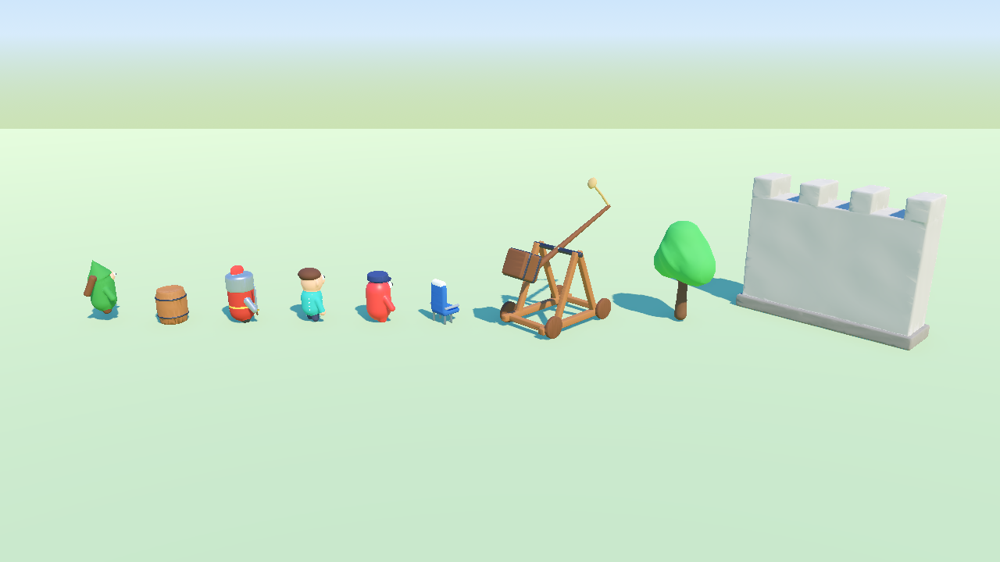
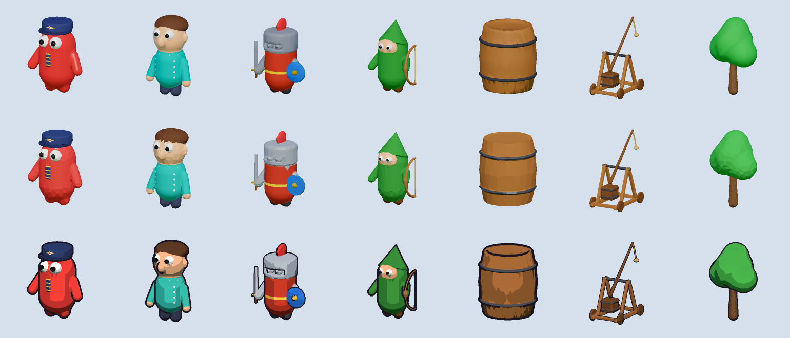

# KILN — Keyed Implicit Language & Notation

KILN turns text into smooth stylised 3D game models. An AI agent (or you) writes a model as a list of simple
shapes that blend into each other like clay; KILN meshes them, paints them from a palette, rigs and animates
them, and builds `.glb` files and Godot scenes. It's the 3D sibling of [PAGAN](https://github.com/lukasgolino/pagan)
(pixel art as text): Claude can't draw, but it can write, and KILN makes the writing into art. No paid
generators, no GPU, no Blender.

**Website:** https://lukasgolino.com/kiln-website/ (live 3D demo, docs). Sister libraries: [PAGAN](https://pagan.top/)
(pixel art) and [SEGAN](https://segan.top/) (audio).



```yaml
name: pilot
class: character
parts:
  - capsule: { from: [0, 0.32, 0], to: [0, 0.74, 0], radius: 0.3 }    # the bean body
    color: red
    material: plastic
  - capsule: { from: [0.3, 0.6, 0], to: [0.42, 0.38, 0.08], radius: 0.08 }
    id: arm_l
    mirror: x
    mirror_id: arm_r
    blend: 0.04                                                    # melts into the body
    color: red
    material: plastic
  - sphere: { at: [0.1, 0.84, 0.23], radius: 0.1 }                  # big googly eyes
    mirror: x
    color: white
    material: plastic
rig:
  arm_l: { pivot: [0.3, 0.6, 0] }
skin: soft
animations:
  walk: { fps: 12, cycle: { type: waddle } }
```

> **Status:** 0.9, pre-1.0: notation, smooth and hard-surface meshing, painting (patterns, decals, palette atlas),
> rigs, soft and rigid skins, clip retargeting (humanoids, or any skeleton with a joint map), animations, effects, five styles, previews, Godot export,
> lint, CC0 imports, a template library, a Claude skill and an MCP server.
> Bugs and requests: [GitHub issues](https://github.com/lukasgolino/KILN/issues).

## One model, any style

A project picks a **style**: how shapes become meshes (smooth or faceted), triangle budgets, material presets and
the look kit (lighting, tonemapping, outlines). The same model text below is soft toy (Dear Passengers, Fall Guys),
low poly and toon. Make your own from inspiration images.



## Install

Requires Python 3.11+.

```sh
pip install "kiln @ git+https://github.com/lukasgolino/KILN@v0.1.0"
kiln --version
```

Development: `python3 -m venv .venv && .venv/bin/pip install -e ".[dev]"`, then `pytest` and `mypy`.

## Quick start

```sh
kiln init my-game-art --style soft_toy    # kiln.toml, palette, BRIEF.md, STYLE.md, models/, styles/
cd my-game-art
kiln new model pilot --template bean      # a rigged bean character to edit
kiln lint                                 # errors and warnings with line numbers
kiln preview pilot                        # previews/pilot/turntable.png: 8 sides x 3 heights
kiln preview pilot --pose walk --closeup arm_l
kiln lineup                               # every model at one scale, with a 1 m bar
kiln build                                # build/models/pilot.glb + manifest.json
```

Every command takes `--json` and exits non-zero on errors. Previews render with KILN's own software renderer (no
GPU, no display); `kiln preview <model> --engine` renders through Godot.

## In Godot

Set `export = ["glb", "godot"]` and `output_dir` inside your Godot project. Each model gets `models/<name>.tscn`
(the glb with the style's materials: toon bands, outlines, rim light) and each style a look kit
`looks/<style>.tscn` (sky, sun, tonemapper, SSAO, glow, colour grading).

```gdscript
add_child(load("res://assets/kiln/looks/soft_toy.tscn").instantiate())   # once per scene
var pilot: Node3D = load("res://assets/kiln/models/pilot.tscn").instantiate()
add_child(pilot)
pilot.get_node("AnimationPlayer").play("walk")
```

`kiln build --verify-godot` loads everything in headless Godot and checks parts, animations and materials.
`manifest.json` is the contract for any engine: files, sizes and bounds in metres, triangles, parts (pivots,
parents, gameplay metadata), animations, variants, LODs and licences. `examples/godot` is a runnable Godot 4.7
project showing the demo models.

## Other engines

The `.glb` files are plain glTF 2.0: Unity, Unreal, Bevy, three.js and Defold import them. Set `export = ["glb"]`.
[docs/engines.md](docs/engines.md) has per-engine notes (axes, scale, vertex colours, palette textures, animations,
LODs) and what's Godot-only (look kits, toon, outlines, rim light) with how to approximate it.

## Using KILN with Claude

```sh
kiln skill install        # copies the skill to .claude/skills/kiln/
```

Then ask: "make a bean pilot for my airline game", "make the knight's helmet detachable", "add a siege tower",
"make everything look more like these screenshots". The skill teaches the workflow: plan in metres, write parts,
lint, LOOK at the previews, check the line-up, report.

## From any agent (MCP)

```sh
pip install "kiln[mcp] @ git+https://github.com/lukasgolino/KILN@v0.1.0"
claude mcp add kiln -- kiln mcp --project ./art     # or any MCP client
```

Tools return the CLI's JSON; previews come back as images. Add `--allow-godot` for Godot verification and engine
renders.

## Free asset packs

For things text does badly (dense foliage, realistic rocks), bring in CC0 models (Kenney, KayKit, Quaternius):
`kiln import tree.glb --licence CC0-1.0 --author Kenney --height 4`. The build snaps their colours to your palette
and applies your style, so they match; `CREDITS.md` lists authors.

## License

MIT — see [LICENSE](LICENSE).
